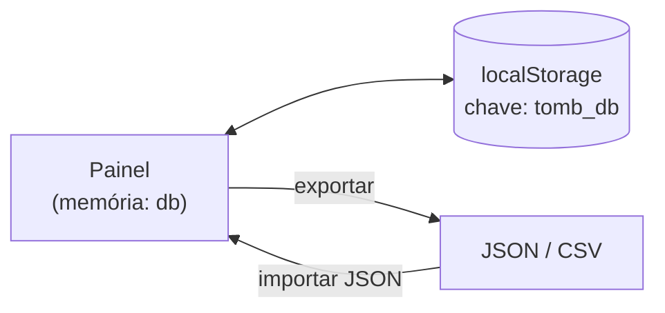
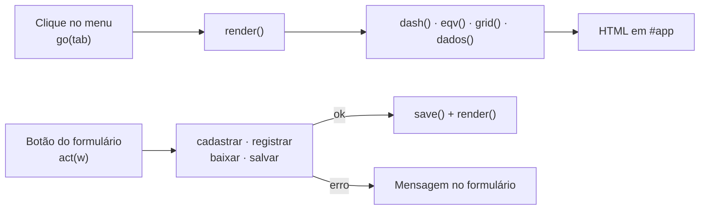

<div align="center">

# 📦 Tombamentos · Control Room

**Painel web para controlar tombamentos de equipamentos: cadastro, transferências entre lojas/setores, baixas e correções, tudo em uma única tela.**


</div>

---

## 📑 Sumário

- [O que o painel faz](#-o-que-o-painel-faz)
- [Como executar](#-como-executar)
- [Telas](#-telas)
- [Processos](#-processos)
- [Regras de negócio](#-regras-de-negócio)
- [Dados e armazenamento](#-dados-e-armazenamento)
- [Estrutura do código](#-estrutura-do-código)
- [Observações importantes](#-observações-importantes)

---

## ✨ O que o painel faz

| | Função |
|---|---|
| ➕ | **Cadastrar** um novo equipamento |
| 🔁 | **Registrar transferências** de um equipamento entre lojas/setores |
| ⬇️ | **Registrar baixas** de tombamentos |
| 🔎 | **Consultar e corrigir** qualquer informação de um equipamento |
| 📊 | Acompanhar **indicadores**, resumo por tipo, situação geral e últimas transferências |
| 📋 | **Editar as tabelas** diretamente, como em uma planilha |
| 💾 | **Exportar/importar** dados (JSON) e exportar tabelas em CSV |

Nenhum campo é bloqueado por lista fechada: **qualquer texto pode ser digitado em qualquer campo**. As listas que aparecem (marcas, unidades, tombamentos) são apenas sugestões.

---

## 🚀 Como executar

1. Mantenha a **estrutura de pastas** abaixo (o HTML carrega o CSS e o JavaScript por caminho relativo).
2. Abra o `tombamentos_painel.html` no navegador (duplo clique).

```text
📁 sua-pasta/
├── 📄 tombamentos_painel.html   ← estrutura da página (HTML)
├── 📁 css/
│   └── 🎨 estilos.css           ← aparência do painel (CSS)
├── 📁 js/
│   └── ⚙️ painel.js             ← lógica do painel (JavaScript)
└── 📁 docs/
    └── 🖼️ dashboard.png         ← imagem usada neste README
```

> **Sem instalação, sem servidor, sem internet.** Não há bibliotecas externas nem CDN.
> Testado no Chromium. Use um navegador atual (Chrome, Edge, Firefox ou Safari recentes).

O painel **abre vazio** na primeira vez: cadastre os equipamentos pelo Dashboard ou traga dados existentes com **Importar JSON**, na aba **Dados**.

---

## 🧭 Telas

O menu superior alterna entre as telas:

| Tela | Para que serve |
|---|---|
| **Dashboard** | Indicadores, formulários de cadastro/transferência/baixa, consulta com correção, resumo e últimas transferências |
| **Equipamentos** | Lista unificada, somente leitura, com busca e filtro por situação. Clicar em uma linha abre a consulta daquele equipamento |
| **Novo Tombamento** | Tabela de equipamentos, editável nas células |
| **Transferência** | Tabela de transferências, editável nas células |
| **Baixa** | Tabela de baixas, editável nas células |
| **Dados** | Backup, importação e exportação em CSV |

### Dashboard em detalhe

| Bloco | Conteúdo |
|---|---|
| **Indicadores** | Equipamentos · Sem tombamento · Transferências · Transferidos · Baixas · Validados |
| **Novo equipamento** | Equipamento, Marca, Tombamento, Unidade/Setor, Nota fiscal, Data da compra |
| **Nova transferência** | Data, Tombamento, Origem, Destino, Responsável, Observação |
| **Consultar e corrigir** | Valores atuais de um tombamento e a coluna **Corrigir para** |
| **Registrar baixa** | Tombamento e Data |
| **Equipamentos por tipo** | Barras com quantidade total e quantidade transferida por tipo |
| **Situação** | Gráfico de rosca com a distribuição das situações |
| **Últimas transferências** | As 8 mais recentes, a mais nova no topo |

---

## ⚙️ Processos

<details>
<summary><b>➕ Cadastrar equipamento</b></summary>

<br>

- **Obrigatórios:** Equipamento e Unidade/Setor.
- O **tombamento é opcional** (equipamentos aguardando número aparecem como *Sem tombamento*).
- Se o tombamento informado **já existir**, nada é gravado.
- O novo equipamento entra com **Validado = Não**.

</details>

<details>
<summary><b>🔁 Registrar transferência</b></summary>

<br>

- **Obrigatórios:** Tombamento e Destino. O tombamento precisa existir em *Novo Tombamento*.
- **Origem vazia** → usa o *local atual* do equipamento.
- **Data vazia** → usa a data de hoje.
- Origem e destino **iguais** (sem diferenciar maiúsculas) são recusados.
- Ao digitar o tombamento, o painel mostra o equipamento e o local atual.

</details>

<details>
<summary><b>⬇️ Registrar baixa</b></summary>

<br>

- O tombamento precisa existir e **não pode já estar baixado**.
- Data vazia → hoje.
- Depois da baixa, a situação do equipamento passa a ser **Baixado**.

</details>

<details>
<summary><b>🔎 Consultar e corrigir</b></summary>

<br>

Digite ou escolha um tombamento. A tabela mostra os valores **Atuais** e a coluna **Corrigir para**:

| Campo | Observação |
|---|---|
| Equipamento, Marca, Unidade/Setor, Nota fiscal | Texto livre |
| Tombamento (nº) | Ao trocar o número, ele também é atualizado nas transferências e baixas |
| Data da compra | Formato `dd/mm/aaaa` |
| Validado | `Sim` ou `Não` |
| Origem, Local atual, Data da última transf. | Alteram o registro da **última transferência** do equipamento |
| Situação, Nº de transferências | Somente leitura (resultado dos demais dados) |

**Como usar:** preencha **só o que mudou** e clique em **SALVAR ALTERAÇÕES**.

- Campo vazio → **não altera**.
- `-` (hífen) → **apaga** o campo. O *Local atual* não pode ficar vazio.
- O tombamento novo **não pode já existir**.
- Tombamento **duplicado** que já tenha transferência ou baixa não pode ser renomeado (não há como saber a qual linha elas pertencem).
- Equipamento **sem transferência**: *Local atual* altera a *Unidade/Setor*; *Origem* e *Data da transferência* são recusadas.
- *Unidade/Setor* e *Local atual* diferentes ao mesmo tempo são recusados.

</details>

<details>
<summary><b>📋 Editar nas tabelas</b></summary>

<br>

- Edite direto nas células; a alteração é salva ao sair do campo.
- **+ linha** adiciona uma linha em branco; **✕** exclui (com confirmação).
- Trocar o tombamento em *Novo Tombamento* segue as mesmas regras da consulta.

</details>

<details>
<summary><b>💾 Aba Dados</b></summary>

<br>

| Botão | Ação |
|---|---|
| **Exportar tudo (JSON)** | Baixa `tombamentos_backup.json` com as três tabelas |
| **Importar JSON** | Substitui os dados atuais (o arquivo precisa ter `novo`, `transf` e `baixa`) |
| **CSV novo / transf / baixa** | Uma tabela em CSV (separador `;`, UTF-8 com BOM, abre direto no Excel) |

</details>

---

## 📐 Regras de negócio

### Situação de um equipamento

A situação é calculada, nunca digitada. A **primeira** regra que se aplica vence:

| # | Condição | Situação |
|---|---|---|
| 1 | Sem número de tombamento | 🔴 **Sem tombamento** |
| 2 | Tombamento consta na tabela de baixas | ⚪ **Baixado** |
| 3 | Tem ao menos uma transferência | 🟠 **Transferido** |
| 4 | Nenhuma das anteriores | 🟢 **Sem transferência** |

### Outras regras

- **Última transferência** = a última linha da tabela de transferências com aquele tombamento.
- **Local atual** = *Destino* da última transferência; sem transferência, a *Unidade/Setor* do cadastro.
- **Tombamento duplicado** aparece com o alerta ⚠ na lista de equipamentos e na consulta.
- **Equipamentos por tipo** agrupam pelo texto do campo *Equipamento*, sem diferenciar maiúsculas:

| Tipo | Regra |
|---|---|
| Computador / PC | contém `computador` ou é exatamente `pc` |
| Notebook · Monitor · Nobreak · Impressora | contém o nome |
| Leitor de preço | contém `preço` |
| PowerBalun | contém `balun` |
| Access Point | é exatamente `ap` |
| Outros | todo o restante |

---

## 🗄️ Dados e armazenamento

### Modelo de dados

Os dados ficam em um objeto com três listas:

| Lista | Campos |
|---|---|
| `novo` (equipamentos) | `equip` · `marca` · `tomb` · `unid` · `nf` · `dcomp` · `val` |
| `transf` (transferências) | `data` · `tomb` · `orig` · `dest` · `resp` · `obs` · `val` |
| `baixa` (baixas) | `tomb` · `data` · `val` |

Datas são guardadas como `aaaa-mm-dd` e exibidas como `dd/mm/aaaa`. O tombamento é sempre **texto**, para preservar zeros à esquerda (`000687`).

### Onde os dados ficam



- Na **primeira abertura** não há dados: as três tabelas começam vazias.
- **Cada alteração é salva automaticamente** no `localStorage`.
- Os dados ficam **neste navegador, neste computador**. Para mover ou guardar, use **Exportar tudo (JSON)**.

---

## 🧩 Estrutura do código

O código é dividido em **três arquivos**, cada um com uma responsabilidade, e organizado em seções comentadas.

| Arquivo | Responsabilidade |
|---|---|
| `tombamentos_painel.html` | Esqueleto da página (21 linhas) |
| `css/estilos.css` | Toda a aparência |
| `js/painel.js` | Dados, regras, processos e telas |

### HTML

```html
<head>   <!-- meta, título e <link rel="stylesheet" href="css/estilos.css"> -->
<body>
  <header>  <!-- título, relógio (#clk) e menu (#nav) -->
  <main id="app">   <!-- a tela atual é desenhada aqui -->
  <div id="toast">  <!-- aviso temporário -->
  <script src="js/painel.js">   <!-- lógica do painel -->
```

O HTML é praticamente um esqueleto: as telas são montadas pelo JavaScript dentro de `#app`.

### CSS

Em `css/estilos.css`, seções comentadas, nesta ordem: *Variáveis de cor · Cabeçalho e navegação · Layout geral e cartões · Indicadores · Formulários e campos · Tabelas · Etiquetas de situação · Gráficos · Aviso temporário · Responsivo*.

| Variável | Uso |
|---|---|
| `--bg` | Fundo da página |
| `--c` | Fundo dos cartões |
| `--b` | Bordas |
| `--t` / `--m` | Texto principal / texto secundário |
| `--bl` `--g` `--y` `--r` | Azul, verde, amarelo e vermelho |

- Os gráficos de barras e a rosca usam **CSS puro** (`conic-gradient`), sem biblioteca.
- Abaixo de 1150 px de largura, as colunas se reorganizam (layout responsivo).

### JavaScript

`js/painel.js` é dividido em seções:

| Seção | O que contém |
|---|---|
| **ARMAZENAMENTO** | Adaptadores de dados e carga inicial |
| **UTIL** | Funções auxiliares: `t` (limpa texto), `n` (minúsculas), `D` (data para `dd/mm/aaaa`), `pd` (interpreta data), `T0` (hoje), `h` (escapa HTML), `toast` |
| **REGRAS** | `lastT`, `situ`, `loc`, `dup` e a lista `TIPOS` |
| **PROCESSOS** | `cadastrar`, `registrar`, `baixar`, `salvar` |
| **TELAS** | `render`, `dash`, `cons`, `eqv`, `grid`, `dados` e os tratadores de eventos |

**Como uma tela é desenhada:**



**Convenção dos campos de formulário (`id`):**

| Prefixo | Formulário |
|---|---|
| `n_` | Novo equipamento (`n_equip`, `n_marca`, `n_tomb`, `n_unid`, `n_nf`, `n_dcomp`) |
| `t_` | Nova transferência (`t_data`, `t_tomb`, `t_orig`, `t_dest`, `t_resp`, `t_obs`) |
| `b_` | Baixa (`b_tomb`, `b_data`) |
| `c_key` | Tombamento consultado |
| `c_` | Campos "Corrigir para" (`c_equip`, `c_marca`, `c_tomb`, `c_unid`, `c_nf`, `c_dcomp`, `c_val`, `c_orig`, `c_dest`, `c_data`) |

Cada processo devolve um resultado simples `{ ok, m }`, em que `m` é a mensagem mostrada ao usuário. Mensagens de sucesso começam com ✔ e as de aviso com ⚠.

### Armazenamento trocável

Toda leitura e gravação passam por um único adaptador, escolhido em uma linha:

```js
const ADAPTER = 'local'; // 'local' = localStorage do navegador
```

Os pontos do código preparados para uma futura integração com servidor e banco estão marcados com comentários `[SERVIDOR/BD n]`. Para listá-los, busque por `[SERVIDOR/BD` em `js/painel.js`.

---

## ⚠️ Observações importantes

- 💾 **Faça backups.** Os dados vivem no `localStorage` do navegador: limpar os dados do navegador apaga o painel. Use **Exportar tudo (JSON)** com frequência.
- 🖥️ **Um navegador, um computador.** Abrir o painel em outro navegador ou máquina começa **vazio**; para levar os dados, exporte o JSON e importe no outro lugar.
- 🔁 **Tombamentos duplicados** são tratados como o mesmo equipamento nas regras de situação (as duas linhas aparecem como transferidas). Por isso o alerta ⚠: corrija o número pela consulta.
- 👥 **Uso individual.** Não há login nem controle de acesso: o painel foi pensado para uma pessoa por vez no próprio computador.